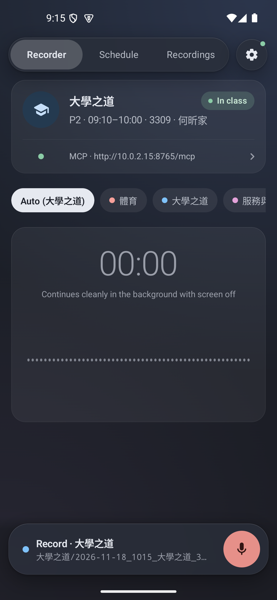

# Class Recorder

**A lecture recorder that actually knows your timetable.**

Stop naming files `Recording_042.m4a` at 2am. Class Recorder syncs your class schedule, works out which course you're sitting in, and files every lecture into its own folder — automatically.

---

## 📱 Look at it

<table>
<tr>
<td align="center"><br><sub><b>Recorder</b><br>Knows you're in 大學之道</sub></td>
<td align="center"><br><sub><b>Schedule</b><br>Your week, with "Now" marked</sub></td>
<td align="center"><br><sub><b>Recordings</b><br>Sorted by day, filtered by course</sub></td>
</tr>
</table>

---

## ✨ What makes it nice

🎯 **Knows what class you're in**
Open the app during a lecture and the course, room, and period are already filled in. No typing.

👍 **One thumb, screen off**
Start, pause, resume, finish. Keeps recording with the screen locked, with a live timer in your notification shade — plus **Android 16 Live Updates** and **HyperOS Island**.

🗂️ **Nothing to organise later**
Every file lands in its course folder with a name you control. Search, filter, scrub the waveform, change speed, or long-press to export a whole subject as one `.zip`.

🎨 **Easy on the eyes**
Light, Dark, or System. Six soft colour themes, or follow your wallpaper. Want your own photo as the background? There's a blur slider too.

🤖 **Optional AI hooks**
Turn on the built-in **MCP server** and any AI assistant on your laptop can read your timetable, start a recording, or write notes straight into a lecture.

---

## 🚀 Getting started

**1. Install** → grab the latest `ClassRecorder-v*-arm64-v8a.apk` from [**Releases**](https://github.com/Rynowastaken/class-recorder/releases).

> Needs **Android 10+** on a 64-bit ARM phone. Allow **Microphone** and **Notifications**.

**2. Add your timetable** → **Schedule** tab → **Sync** → paste your `uni-campus` share link or NUTC timetable URL.

**3. Record** → the card at the top tells you what's happening:

| Card says | Means |
| :--- | :--- |
| 🟢 **In class** | A lecture is on right now — just hit record |
| 🔵 **Upcoming class** | Next period, shown ahead of time |
| ⚪ **Ready** | Nothing scheduled — tap to pick a course manually |

Hit **Record** at the bottom. While recording you can **Pause**, **Resume**, **Discard**, or **Finish** — from the app or the notification.

**4. Review** → open **Recordings** and tap any lecture:

- 🎚️ drag the waveform to jump around
- ⏩ speed: `0.5×` `1×` `1.25×` `1.5×` `2×`
- 📝 write notes and save
- 📤 share to Drive, Notion, Telegram, or your laptop

Long-press to select several and export them as one `.zip`.

---

## 🎛️ Make it yours

### 📝 File names

**Settings → File naming** — a live preview updates as you type.

| Placeholder | Output | Meaning |
| :--- | :--- | :--- |
| `{class}` | `作業系統` | Course name (or `Uncategorized`) |
| `{date}` | `2026-11-18` | Date (`yyyy-MM-dd`, `yyyyMMdd`, `MM-dd`, …) |
| `{time}` | `1300` | Start time |
| `{lesson number}` | `3` | How many recordings for that course |
| `{room}` | `1508` | Classroom |
| `{teacher}` | `黃世豪` | Instructor |
| `{slot}` | `P5` | Period number |

### 🖼️ Background

**Settings → Background** — pick any photo as the backdrop. It's copied into app storage, rotated correctly, and blurred behind the glass cards.

The **Blur** slider runs from sharp to fully frosted, and the scrim adjusts itself so light photos don't wash out the text. Tap **Reset** for the default Mist gradient.

---

## 🧩 Optional extras

<details>
<summary><b>📲 Live island / promoted notifications</b></summary>

<br>

Class Recorder always shows a normal notification. On **Android 16+** and **Xiaomi HyperOS**, the fancier status-bar pill needs a shell permission:

1. Install [Shizuku](https://shizuku.rikka.app/) and start it
2. Open Class Recorder → approve the prompt in **Settings**
3. The live timer now appears in the status bar / HyperOS Island

Without it, recording works exactly the same — you just get the standard notification.

</details>

<details>
<summary><b>🤖 Connecting an AI assistant (MCP)</b></summary>

<br>

1. **Settings → MCP server** → **On**. Default port `8765`; optional Bearer password.
2. **Same Wi-Fi** → `http://<phone-ip>:8765/mcp`
3. **Over USB** → `adb forward tcp:8765 tcp:8765`, then `http://127.0.0.1:8765/mcp`

Your assistant can then check your timetable, see what class is on now, start/stop recordings, list past lectures, and write notes into any recording.

</details>

<details>
<summary><b>🔧 Building from source</b></summary>

<br>

| Path | What's in it |
| :--- | :--- |
| `android-app/` | Jetpack Compose app (Kotlin 2.0, `minSdk 29`, `compileSdk 36`) |
| `rust-core/` | Rust core — SQLite, timetable parser, JNI bridge, `axum` MCP server |
| `scripts/build-rust-android.sh` | NDK build for `libclass_recorder_core.so` |
| `PRODUCT.md` · `DESIGN.md` | Product brief and Mist Glass design system |

**You'll need:** JDK 17+, Android SDK (`compileSdk 36`) + NDK r27+, and Rust with `rustup target add aarch64-linux-android`.

```bash
cargo test --manifest-path rust-core/Cargo.toml
./scripts/build-rust-android.sh

cd android-app
./gradlew :app:testClassrecorderTestDebugUnitTest :app:assembleClassrecorderRelease
```

Output: `android-app/app/build/outputs/apk/classrecorder/release/app-classrecorder-release.apk`

There's also a `classrecorderTest` flavor (`com.ryno.classrecorder.uitest`) via `:app:assembleClassrecorderTestDebug` so UI testing never touches real recordings.

**Signing:** release builds fall back to the debug key. For Play Store or shared builds:

```bash
export KEYSTORE_PATH=/path/to/release.jks
export KEYSTORE_PASSWORD=...
export KEY_ALIAS=...
export KEY_PASSWORD=...
```

</details>
