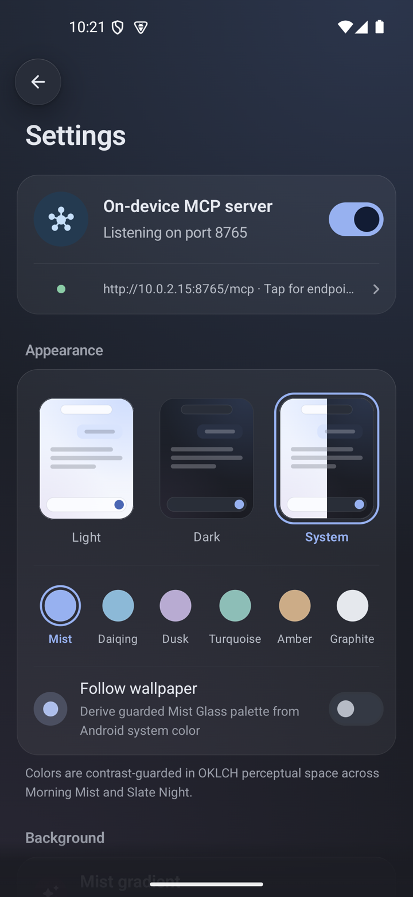

# Class Recorder

Records your lectures and files them by course — automatically. It reads your timetable, knows which class you're in, and sorts every lecture into the right folder.

---

<table>
<tr>
<td align="center" valign="top"><br><b>Record</b><br><sub>already knows your class</sub></td>
<td align="center" valign="top"><br><b>Schedule</b><br><sub>your week at a glance</sub></td>
<td align="center" valign="top"><br><b>Recordings</b><br><sub>sorted by day</sub></td>
</tr>
</table>

---

## 🚀 Get started

**1. Install** — grab the APK from [**Releases**](https://github.com/Rynowastaken/class-recorder/releases). Android 10+, 64-bit ARM. Allow Microphone + Notifications.

**2. Sync timetable** — Schedule tab → **Sync** → paste your `uni-campus` share link.

**3. Record** — hit the red button. The card up top shows your class: 🟢 **In class** · 🔵 **Up next** · ⚪ **Ready**.

**4. Review** — Recordings tab → tap a lecture for waveform, speed (`0.5×`–`2×`), and notes.

---

## 🎨 Make it yours

**Settings → Background** — use any photo as a backdrop, with a blur slider.

**Settings → File naming** — build names from `{class}` `{date}` `{time}` `{room}` `{teacher}` `{lesson number}`, with a live preview.

**Appearance** — Light / Dark / System, six themes, or follow your wallpaper.

---

## 🤖 Optional

**AI assistant** — Settings → MCP server → On. Connect at `http://<phone-ip>:8765/mcp`.

**Live island** — Android 16 / HyperOS only. Nothing to set up: the recording notification and its pause/stop controls always work.

---

<details>
<summary><b>🔧 Build from source</b></summary>

<br>

Needs JDK 17+, Android SDK 36, NDK r27+, Rust with `aarch64-linux-android`.

```bash
cargo test --manifest-path rust-core/Cargo.toml
./scripts/build-rust-android.sh

cd android-app
./gradlew :app:testClassrecorderTestDebugUnitTest :app:assembleClassrecorderRelease
```

Release builds use the debug key unless `KEYSTORE_PATH`, `KEYSTORE_PASSWORD`, `KEY_ALIAS`, and `KEY_PASSWORD` are set.

</details>
