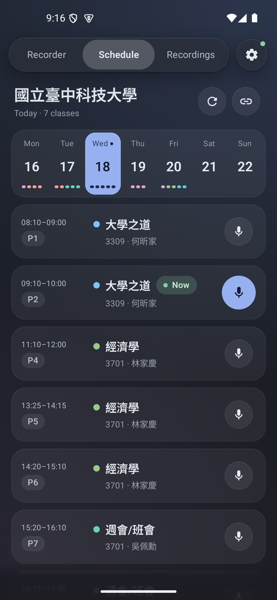
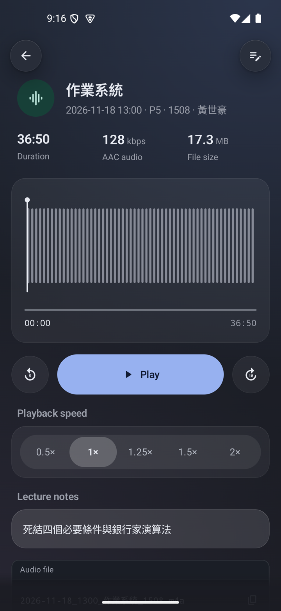

# Class Recorder

**A lecture recorder that actually knows your timetable.**

Most voice-recorder apps hand you `Recording_042.m4a` at finals week. Class Recorder syncs your class schedule, figures out which course you're sitting in right now, and files every lecture into its own folder with a filename that makes sense six months later.

---

## What it looks like

<table>
<tr>
<td align="center"><br><sub><b>Recorder</b> — knows you're in 大學之道, P2, room 3309</sub></td>
<td align="center"><br><sub><b>Schedule</b> — your week, with "Now" marked</sub></td>
<td align="center"><br><sub><b>Recordings</b> — grouped by day, filtered by course</sub></td>
</tr>
<tr>
<td align="center"><br><sub><b>Playback</b> — waveform, speed, and your notes</sub></td>
<td align="center"><br><sub><b>Settings</b> — themes, wallpaper, MCP server</sub></td>
<td></td>
</tr>
</table>

---

## Why people use it

- **It knows what class you're in.** Import your schedule once. Open the app during (or up to 10 minutes before) a lecture and the right course, room, and period are already filled in. No typing, no naming files at 2am.

- **One thumb, screen off.** Start, pause, resume, finish. Recording keeps going with the screen locked, and the live timer is right there in your notification shade — including **Android 16 Live Updates** and **Xiaomi HyperOS Island** support.

- **Nothing to organise later.** Every recording lands in its course folder with a filename you control. Search across titles and notes, filter by course, scrub the waveform, change speed, or long-press to export a whole subject as one `.zip`.

- **Easy on the eyes.** The **Mist Glass** interface: Light, Dark, or System, six soft colour themes, or let it follow your wallpaper. You can also set your own photo as the background, with a blur slider so it never fights the text.

- **Optional AI hooks.** Flip on the built-in **MCP server** and any AI assistant on your laptop can read your timetable, start a recording, or write study notes straight into a lecture.

---

## Getting started

### 1. Install

Grab the latest `ClassRecorder-v*-arm64-v8a.apk` from the [**Releases**](https://github.com/Rynowastaken/class-recorder/releases) page.

Requires **Android 10 or newer** on a 64-bit ARM phone. Allow **Microphone** (obviously) and **Notifications** (so you can control recordings with the screen off).

### 2. Bring in your timetable

Open the **Schedule** tab, tap **Sync**, and paste your `uni-campus` share link, share code, or NUTC timetable JSON address. Your week fills in — tap any class to start recording for it directly.

### 3. Record

On the **Recorder** tab, the class card at the top tells you what's happening:

| What it says | What it means |
| :--- | :--- |
| **In class** | You're in a scheduled lecture right now — just hit record |
| **Upcoming class** | Next period, shown ahead of time |
| **Ready** | Nothing scheduled; tap to pick a course or record as Unscheduled |

Hit **Record** at the bottom. While recording you can **Pause**, **Resume**, **Discard**, or **Finish** from the app or from the notification.

### 4. Review, annotate, share

Open **Recordings** to browse by day or filter by course. Tap any lecture to:

- drag across the waveform to jump to a moment
- switch between `0.5×`, `1×`, `1.25×`, `1.5×`, and `2×`
- write notes in **Lecture notes** and save
- share the `.m4a` to Drive, Notion, Telegram, or your laptop

To back up a whole subject, **long-press** a recording to enter selection mode and export everything as a single `.zip`.

---

## Making it yours

### File names

In **Settings → File naming** you control how recordings are named:

| Placeholder | Output | Meaning |
| :--- | :--- | :--- |
| `{class}` | `作業系統` | Course name (or `Uncategorized`) |
| `{date}` | `2026-11-18` | Recording date (`yyyy-MM-dd`, `yyyyMMdd`, `MM-dd`, …) |
| `{time}` | `1300` | Start time (`HHmm`) |
| `{lesson number}` | `3` | How many recordings you've made for that course |
| `{room}` | `1508` | Classroom from your schedule |
| `{teacher}` | `黃世豪` | Instructor |
| `{slot}` | `P5` | Period number |

A live preview updates as you type, so you can see the result before saving.

### Background

**Settings → Background** lets you pick any photo as the app backdrop. It gets copied into app storage, rotated correctly, and blurred behind the glass cards. The **Blur** slider runs from sharp to fully frosted — the scrim underneath adjusts automatically based on how bright your photo is, so light images don't wash out the text.

Tap **Reset** to go back to the built-in Mist gradient.

---

## Optional extras

### Live island / promoted notifications

Class Recorder always shows a normal recording notification. On **Android 16+** and **Xiaomi HyperOS**, the fancier status-bar pill is gated behind a shell permission:

1. Install and start [Shizuku](https://shizuku.rikka.app/).
2. Open Class Recorder and approve the one-time prompt in **Settings**.
3. The live timer now appears in the status bar / HyperOS Island.

Without it, recording still works exactly the same — you just get the standard notification.

### Connecting an AI assistant (MCP)

If you use an MCP client like Claude Code, Cursor, or a local study agent:

1. **Settings → MCP server** → turn it **On**. Default port is `8765`; you can add a Bearer password.
2. **Same Wi-Fi:** point your client at `http://<phone-ip>:8765/mcp`.
3. **Over USB:** `adb forward tcp:8765 tcp:8765`, then connect to `http://127.0.0.1:8765/mcp`.

Your assistant can then check the timetable, see what class is happening now, start/stop recordings, list past lectures, and write notes into any recording.

---

<details>
<summary><strong>Building from source</strong></summary>

### Layout

| Path | What's in it |
| :--- | :--- |
| `android-app/` | Jetpack Compose app (Kotlin 2.0, `minSdk 29`, `compileSdk 36`) |
| `rust-core/` | Rust core — SQLite storage, timetable parser, JNI bridge, `axum` MCP server |
| `scripts/build-rust-android.sh` | NDK build script for `libclass_recorder_core.so` |
| `PRODUCT.md`, `DESIGN.md` | Product brief and the Mist Glass design system |
| `docs/screenshots/` | Screenshots used above |

### You'll need

- **JDK 17+**
- **Android SDK** (`compileSdk 36`) and **NDK r27+** (`ANDROID_HOME` / `ANDROID_NDK_HOME`)
- **Rust** with `rustup target add aarch64-linux-android`

### Build

```bash
# 1. Test and build the native library into jniLibs/
cargo test --manifest-path rust-core/Cargo.toml
./scripts/build-rust-android.sh

# 2. Test and assemble the optimized release APK
cd android-app
./gradlew :app:testClassrecorderTestDebugUnitTest :app:assembleClassrecorderRelease
```

Output: `android-app/app/build/outputs/apk/classrecorder/release/app-classrecorder-release.apk`

A side-by-side `classrecorderTest` flavor (`com.ryno.classrecorder.uitest`) is available via `:app:assembleClassrecorderTestDebug` so UI testing never touches real recordings.

### Signing

Release builds fall back to the debug key when no keystore is configured. For Play Store or shared builds, supply:

```bash
export KEYSTORE_PATH=/path/to/release.jks
export KEYSTORE_PASSWORD=...
export KEY_ALIAS=...
export KEY_PASSWORD=...
```

</details>
